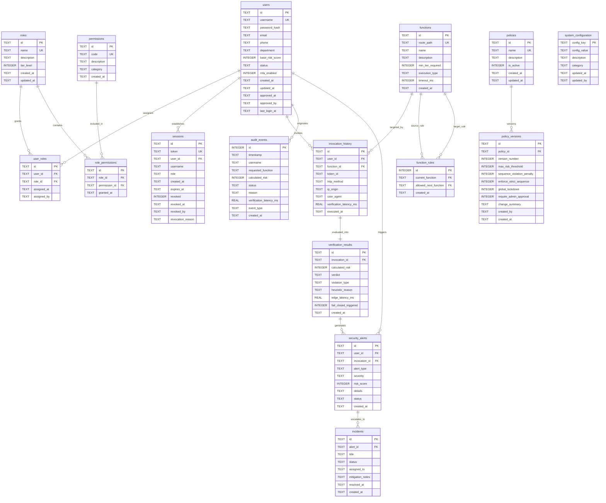

# DATABASE DESIGN DOCUMENTATION & NORMALIZED D1 SCHEMA

**Project:** Serverless Security Verification Framework  
**Database Technology:** Cloudflare D1 (Serverless Distributed SQLite Engine)  
**Schema Architecture:** 3rd Normal Form (3NF) Normalized Relational Schema  
**Design Version:** v2.0.0-Normalized  

---

## 1. Entity-Relationship (ER) Diagram

---

## 2. Normalized Table Specifications

### 2.1 Table: `users`
Stores identity credentials, Zero-Trust clearance statuses, and baseline behavioral threat profiles.
- **`id`** (`TEXT PRIMARY KEY`): Unique identity identifier (e.g., `usr_9x7k2`).
- **`username`** (`TEXT UNIQUE NOT NULL`): Unique user handle.
- **`password_hash`** (`TEXT NOT NULL`): Salted cryptographic password hash.
- **`email`** (`TEXT UNIQUE`): Corporate/identity email.
- **`phone`** (`TEXT`): Masked phone number for two-factor authentication.
- **`department`** (`TEXT`): Operational unit (e.g. `SecOps Core Operations`).
- **`base_risk_score`** (`INTEGER NOT NULL DEFAULT 20`): Range 0–100.
- **`status`** (`TEXT NOT NULL DEFAULT 'PENDING_APPROVAL'`): Check constraint: `CHECK(status IN ('APPROVED', 'PENDING_APPROVAL', 'REJECTED', 'SUSPENDED'))`.
- **`mfa_enabled`** (`INTEGER NOT NULL DEFAULT 1`): Boolean flag (1=Active).
- **`created_at`** (`TEXT NOT NULL DEFAULT (datetime('now'))`).
- **`updated_at`** (`TEXT NOT NULL DEFAULT (datetime('now'))`).
- **`approved_at`** (`TEXT`): Timestamp of administrative clearance.
- **`approved_by`** (`TEXT`): Administrator username who granted clearance.
- **`last_login_at`** (`TEXT`): Most recent authentication timestamp.
- **Indexes:** `idx_users_username`, `idx_users_status`, `idx_users_role`.

### 2.2 Table: `roles`
Defines system access tiers under the Role-Based Access Control model.
- **`id`** (`TEXT PRIMARY KEY`): e.g., `role_admin`, `role_developer`, `role_guest`.
- **`name`** (`TEXT UNIQUE NOT NULL`): `Admin`, `Developer`, `Guest`.
- **`description`** (`TEXT NOT NULL`): Narrative role explanation.
- **`tier_level`** (`INTEGER NOT NULL`): 3 (Admin), 2 (Developer), 1 (Guest).
- **`created_at`**, **`updated_at`**.

### 2.3 Table: `permissions`
Atomic functional capabilities in the serverless ecosystem.
- **`id`** (`TEXT PRIMARY KEY`): e.g., `perm_policy_write`, `perm_worker_deploy`.
- **`code`** (`TEXT UNIQUE NOT NULL`): Permission code string.
- **`description`** (`TEXT NOT NULL`).
- **`category`** (`TEXT NOT NULL`): `POLICY`, `DEPLOYMENT`, `AUDIT`, `IDENTITY`.

### 2.4 Table: `user_roles` (Join Table)
Many-to-many relationship mapping users to roles.
- **`id`** (`TEXT PRIMARY KEY`).
- **`user_id`** (`TEXT NOT NULL REFERENCES users(id) ON DELETE CASCADE`).
- **`role_id`** (`TEXT NOT NULL REFERENCES roles(id) ON DELETE CASCADE`).
- **`assigned_at`**, **`assigned_by`**.
- **Constraint:** `UNIQUE(user_id, role_id)`.

### 2.5 Table: `role_permissions` (Join Table)
Many-to-many relationship mapping roles to atomic permissions.
- **`id`** (`TEXT PRIMARY KEY`).
- **`role_id`** (`TEXT NOT NULL REFERENCES roles(id) ON DELETE CASCADE`).
- **`permission_id`** (`TEXT NOT NULL REFERENCES permissions(id) ON DELETE CASCADE`).
- **`granted_at`**.
- **Constraint:** `UNIQUE(role_id, permission_id)`.

### 2.6 Table: `policies`
Defines active zero-trust security policy entities.
- **`id`** (`TEXT PRIMARY KEY`): e.g., `pol_enterprise_edge`.
- **`name`** (`TEXT UNIQUE NOT NULL`).
- **`description`** (`TEXT`).
- **`is_active`** (`INTEGER NOT NULL DEFAULT 1`).
- **`created_at`**, **`updated_at`**.

### 2.7 Table: `policy_versions`
Historical and active versioned rulesets enforcing immutable policy audits.
- **`id`** (`TEXT PRIMARY KEY`): e.g., `polver_v2_4`.
- **`policy_id`** (`TEXT NOT NULL REFERENCES policies(id) ON DELETE CASCADE`).
- **`version_number`** (`INTEGER NOT NULL`).
- **`max_risk_threshold`** (`INTEGER NOT NULL DEFAULT 75`): Boundary cutoff.
- **`sequence_violation_penalty`** (`INTEGER NOT NULL DEFAULT 40`).
- **`enforce_strict_sequence`** (`INTEGER NOT NULL DEFAULT 1`).
- **`global_lockdown`** (`INTEGER NOT NULL DEFAULT 0`).
- **`require_admin_approval`** (`INTEGER NOT NULL DEFAULT 1`).
- **`change_summary`** (`TEXT`).
- **`created_by`** (`TEXT NOT NULL`).
- **`created_at`**.
- **Constraint:** `UNIQUE(policy_id, version_number)`.

### 2.8 Table: `functions`
Catalog of protected serverless cloud endpoints.
- **`id`** (`TEXT PRIMARY KEY`): e.g., `fn_deploy_worker`.
- **`route_path`** (`TEXT UNIQUE NOT NULL`): e.g., `/api/deployWorkerCode`.
- **`name`** (`TEXT NOT NULL`).
- **`description`** (`TEXT`).
- **`min_tier_required`** (`INTEGER NOT NULL DEFAULT 2`): Minimum role tier required.
- **`execution_type`** (`TEXT NOT NULL CHECK(execution_type IN ('MUTATION', 'QUERY', 'SYSTEM'))`).
- **`timeout_ms`** (`INTEGER NOT NULL DEFAULT 5000`).
- **`created_at`**.

### 2.9 Table: `invocation_history`
Raw record of incoming serverless requests prior to verification decision.
- **`id`** (`TEXT PRIMARY KEY`): UUID or monotonic token.
- **`user_id`** (`TEXT REFERENCES users(id)`).
- **`function_id`** (`TEXT NOT NULL REFERENCES functions(id)`).
- **`token_id`** (`TEXT`).
- **`http_method`** (`TEXT NOT NULL`).
- **`ip_origin`** (`TEXT`).
- **`user_agent`** (`TEXT`).
- **`verification_latency_ms`** (`REAL NOT NULL`).
- **`executed_at`** (`TEXT NOT NULL DEFAULT (datetime('now'))`).
- **Indexes:** `idx_invocations_user`, `idx_invocations_function`, `idx_invocations_time`.

### 2.10 Table: `verification_results`
Decisions output by the Bλambda Markov verification pipeline.
- **`id`** (`TEXT PRIMARY KEY`).
- **`invocation_id`** (`TEXT UNIQUE NOT NULL REFERENCES invocation_history(id)`).
- **`calculated_risk`** (`INTEGER NOT NULL`).
- **`verdict`** (`TEXT NOT NULL CHECK(verdict IN ('ALLOWED', 'BLOCKED'))`).
- **`violation_type`** (`TEXT`): e.g., `SEQUENCE_VIOLATION`, `RATE_LIMIT`, `FAIL_CLOSED`.
- **`heuristic_reason`** (`TEXT NOT NULL`).
- **`edge_latency_ms`** (`REAL NOT NULL`).
- **`fail_closed_triggered`** (`INTEGER NOT NULL DEFAULT 0`).
- **`created_at`**.

### 2.11 Table: `security_alerts`
Flags anomalous behaviors requiring SOC review.
- **`id`** (`TEXT PRIMARY KEY`).
- **`user_id`** (`TEXT REFERENCES users(id)`).
- **`invocation_id`** (`TEXT REFERENCES invocation_history(id)`).
- **`alert_type`** (`TEXT NOT NULL`): e.g., `PROMPT_INJECTION`, `SSRF_ATTEMPT`, `REVOKED_REPLAY`.
- **`severity`** (`TEXT NOT NULL CHECK(severity IN ('CRITICAL', 'HIGH', 'MEDIUM', 'LOW'))`).
- **`risk_score`** (`INTEGER NOT NULL`).
- **`details`** (`TEXT NOT NULL`).
- **`status`** (`TEXT NOT NULL DEFAULT 'NEW' CHECK(status IN ('NEW', 'ACKNOWLEDGED', 'RESOLVED', 'FALSE_POSITIVE'))`).
- **`created_at`**.

### 2.12 Table: `incidents`
Elevated multi-alert security cases for post-mortem analysis.
- **`id`** (`TEXT PRIMARY KEY`).
- **`alert_id`** (`TEXT REFERENCES security_alerts(id)`).
- **`title`** (`TEXT NOT NULL`).
- **`status`** (`TEXT NOT NULL DEFAULT 'OPEN' CHECK(status IN ('OPEN', 'INVESTIGATING', 'CONTAINED', 'RESOLVED'))`).
- **`assigned_to`** (`TEXT`).
- **`mitigation_notes`** (`TEXT`).
- **`resolved_at`**, **`created_at`**.

### 2.13 Table: `audit_events` (High-Assurance Primary Ledger)
Primary tamper-resistant ledger tracking all invocation decisions with latency metrics.
- **`id`** (`INTEGER PRIMARY KEY AUTOINCREMENT`).
- **`timestamp`** (`TEXT NOT NULL DEFAULT (datetime('now'))`).
- **`username`** (`TEXT NOT NULL`).
- **`requested_function`** (`TEXT NOT NULL`).
- **`calculated_risk`** (`INTEGER NOT NULL`).
- **`status`** (`TEXT NOT NULL CHECK(status IN ('ALLOWED', 'BLOCKED'))`).
- **`reason`** (`TEXT NOT NULL`).
- **`verification_latency_ms`** (`REAL NOT NULL`).
- **`event_type`** (`TEXT DEFAULT 'STANDARD_VERIFICATION'`).
- **`created_at`** (`TEXT NOT NULL DEFAULT (datetime('now'))`).
- **Indexes:** `idx_audit_events_user`, `idx_audit_events_latency`, `idx_audit_events_timestamp`.

### 2.14 Table: `sessions` (Real-Time Revocation Registry)
Active and revoked authentication sessions.
- **`id`** (`TEXT PRIMARY KEY`).
- **`token`** (`TEXT UNIQUE NOT NULL`).
- **`user_id`** (`TEXT REFERENCES users(id) ON DELETE CASCADE`).
- **`username`** (`TEXT NOT NULL`).
- **`role`** (`TEXT NOT NULL`).
- **`created_at`** (`TEXT NOT NULL DEFAULT (datetime('now'))`).
- **`expires_at`** (`TEXT NOT NULL`).
- **`revoked`** (`INTEGER NOT NULL DEFAULT 0`).
- **`revoked_at`** (`TEXT`).
- **`revoked_by`** (`TEXT`).
- **`revocation_reason`** (`TEXT`).
- **Indexes:** `idx_sessions_token`, `idx_sessions_revoked`, `idx_sessions_user`.

### 2.15 Table: `system_configuration`
Dynamic key-value parameters for edge cluster tuning.
- **`config_key`** (`TEXT PRIMARY KEY`).
- **`config_value`** (`TEXT NOT NULL`).
- **`description`** (`TEXT`).
- **`category`** (`TEXT NOT NULL DEFAULT 'GENERAL'`).
- **`updated_at`**, **`updated_by`**.

---

## 3. Data Retention & Archival Policies

1. **High-Frequency Invocations (`invocation_history`):** Hot storage at edge for 30 days. Automated partition rollover to compressed cold storage (`R2` / archive snapshots).
2. **Audit Ledger Records (`audit_events`):** Indefinite retention (immutable append-only policy) satisfying SOC-2 Type II and ISO/IEC 27001 requirements.
3. **Session Records (`sessions`):** Expired sessions ($> 7\text{ days}$) purged automatically; revoked session tokens retained permanently to prevent replay attacks.
