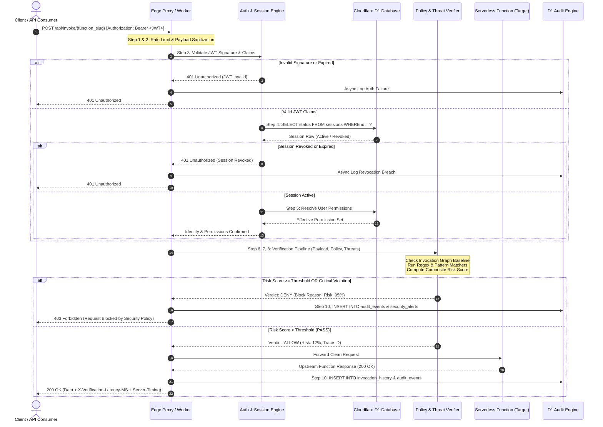

# Data Flow Architecture & Request Lifecycle Specification

**Project**: Design and Implementation of an Integrated Real-Time Security Verification Framework for Serverless Cloud Applications  
**Publication Target**: IEEE Access / Bλambda Foundation (B.Tech CSE Capstone 2026–2027)  
**Document Status**: APPROVED — ARCHITECTURE PHASE 2  

---

## 1. Executive Summary

This document specifies the end-to-end data flow and runtime pipeline for the Serverless Cloud Security Verification Framework. The framework operates as an inline reverse proxy and verification sidecar (deployed as a Cloudflare Worker or Edge Gateway) intercepting HTTP/JSON invocations destined for upstream serverless functions (AWS Lambda, Cloudflare Workers, Google Cloud Run).

The primary objective is to evaluate every invocation against behavioral baselines, cryptographically validated JWT identities, active session status in Cloudflare D1, fine-grained Role-Based Access Control (RBAC), and multi-vector threat detection patterns in under **10 milliseconds** before either granting upstream execution or terminating the request with fail-closed semantics.

---

## 2. Complete 11-Step Request Lifecycle

The lifecycle follows a strictly ordered, non-bypassable sequence. Every request traverses these 11 pipeline gates:

```
[Client Request]
       │
       ▼
1. Edge Entry Point (Cloudflare Worker / Express Proxy)
       │
       ▼
2. Request Structural Validation & Sanitization (Payload Size, Headers, Content-Type)
       │
       ▼
3. Cryptographic Authentication & Signature Validation (RS256/HS256 JWT, Expiry, Issuer)
       │
       ▼
4. Real-Time D1 Session Verification (Active Status, Revocation Check, IP Fingerprint)
       │
       ▼
5. Fine-Grained Authorization (RBAC: User -> User_Roles -> Roles -> Role_Permissions)
       │
       ▼
6. Invocation Verification (Invocation Hash, Replay Detection, Parameter Boundary Check)
       │
       ▼
7. Behavioral Policy Evaluation (Invocation Graph Deviation, Rate Limits, Quota)
       │
       ▼
8. Multi-Vector Threat Detection (SSRF/IMDS, SQLi, NoSQLi, Prompt Injection, Shellcode)
       │
       ▼
9. Decision Arbiter (Allow, Block, or Quarantine with Fail-Closed Fallback)
       │
       ├─── [DENIED] ──► Immediate 403 Forbidden / 401 Unauthorized Response
       │                       │
       └─── [ALLOWED] ─► Forward to Upstream Serverless Function Handler
                               │
                               ▼
10. Immutable Audit Persistence (Batched Asynchronous Write to D1 `audit_events`)
                               │
                               ▼
11. Secure Response Delivery (Client Response with `X-Verification-Latency-MS`, `Server-Timing`)
```

---

## 3. Sequence Diagram (Mermaid)



---

## 4. In-Depth Step Analysis

### Step 1: Edge Entry Point
- Intercepts incoming requests at the nearest Cloudflare Edge Point of Presence (PoP) or Node.js reverse proxy.
- Records `ingress_timestamp` using high-resolution timers (`performance.now()`).
- Injects a distributed tracing header `x-verification-trace-id: trace_<uuidv4>`.
- Enforces an IP-level rate limiting token bucket stored in edge memory (`100 req/60s` per IP).

### Step 2: Request Structural Validation
- **Size Bounds**: Invocations exceeding `512 KB` are immediately rejected with HTTP `413 Payload Too Large`.
- **Content-Type Enforcement**: Must strictly match `application/json` (or `multipart/form-data` with explicit boundary validation).
- **Malformed JSON Check**: Non-parseable JSON generates HTTP `400 Bad Request` and increments the IP threat counter.

### Step 3: Cryptographic Authentication
- Extracts `Authorization: Bearer <token>`.
- Validates the token format: standard base64url-encoded three-part JWT (`header.payload.signature`).
- Verifies HMAC-SHA256 signature against `JWT_SECRET` (or RS256 public key in multi-tenant environments).
- Validates standard registered claims:
  - `exp`: Must be in the future (no grace period for serverless high-security execution).
  - `nbf`: Current timestamp must be $\ge$ `nbf`.
  - `iss`: Must equal configured issuer (`https://auth.serverless-security.local`).
  - `aud`: Target audience must match the specific API or wildcard service.

### Step 4: Real-Time D1 Session Verification
- Stateless JWTs are insufficient for immediate revocation (e.g., when an administrator revokes a compromised analyst session).
- Queries the `sessions` table in D1 using the `jti` (JWT ID) or `session_token`:
  ```sql
  SELECT id, user_id, status, expires_at, ip_address 
  FROM sessions 
  WHERE session_token = ? AND status = 'active' AND expires_at > CURRENT_TIMESTAMP;
  ```
- If the record does not exist or `status == 'revoked'`, the verification pipeline terminates with HTTP `401 Unauthorized` (`REVOKED_SESSION_REPLAY_ATTEMPT`).

### Step 5: Fine-Grained Authorization (RBAC)
- Traverses the relational permission graph:
  $$\text{User} \xrightarrow{} \text{User\_Roles} \xrightarrow{} \text{Roles} \xrightarrow{} \text{Role\_Permissions} \xrightarrow{} \text{Permissions}$$
- Maps the requested operation (e.g., `fn:payment-processing:invoke` or `admin:security-matrix:view`) against the user's cached permission bitmap.
- If permission is absent, request terminates with HTTP `403 Forbidden` (`INSUFFICIENT_PERMISSIONS`).

### Step 6: Invocation Verification (Hash & Replay Detection)
- Calculates SHA-256 digest of `(user_id + function_id + payload_bytes + timestamp_bucket)`.
- Prevents replay attacks by checking a fast TTL cache (120-second sliding window).
- Validates that parameters match the target serverless function's declared JSON schema stored in the `functions` table.

### Step 7: Behavioral Policy Evaluation
- Retrieves the active policy for the target function from the `policies` table.
- Evaluates the **Invocation Graph Baseline**:
  - Validates whether the calling function or user is permitted in the defined call graph sequence (e.g., `api-gateway` $\rightarrow$ `order-service` $\rightarrow$ `payment-service`).
  - Flags out-of-order invocations (e.g., direct call to `payment-service` bypassing `order-service`) as critical sequence deviations.

### Step 8: Multi-Vector Threat Detection Engine
The payload, headers, query parameters, and metadata are scanned in parallel using deterministic pattern matchers:
1. **SSRF / Cloud Metadata Service (IMDS)**:
   - Probes targeting `169.254.169.254`, `metadata.google.internal`, or `100.100.100.200`.
   - Obfuscated IP variations (decimal `2852039166`, hex `0xa9.0xfe.0xa9.0xfe`, IPv6 mapped `::ffff:169.254.169.254`).
2. **Serverless Command / Shell Injection**:
   - `sh`, `bash`, `curl`, `wget`, reverse shells, backticks, `$()`, pipe operators intended to spawn child processes within Lambda containers.
3. **Prompt Injection / Jailbreaks**:
   - Invocations routing to LLM functions are inspected for delimiter manipulation (`---system---`, `Ignore previous instructions`, `DAN Mode`).
4. **NoSQL / SQL Injection**:
   - MongoDB operator injection (`$gt`, `$ne`, `$where`) and classic SQL union/blind probes.

### Step 9: Decision Arbiter (Fail-Closed Architecture)
- Aggregates risk points across all checks:
  $$\text{Composite Risk} = \sum (\text{Vector Weight} \times \text{Confidence Score})$$
- Evaluates against the configured `BLOCK_THRESHOLD` (default: 75%):
  - **$\text{Risk} \ge 75\%$**: Verdict = `DENY`. Injects HTTP 403 response with diagnostic code.
  - **$40\% \le \text{Risk} < 75\%$**: Verdict = `QUARANTINE_LOG` (Execute upstream with degraded privilege, flag alert).
  - **$\text{Risk} < 40\%$**: Verdict = `ALLOW`.
- **Fail-Closed Guarantee**: Any uncaught exception inside the verification logic automatically forces Verdict = `DENY`, risk score = 100%, and status = 403.

### Step 10: Immutable Audit Persistence
- Asynchronously persists the transaction to Cloudflare D1 without delaying client response:
  - Writes execution metrics to `invocation_history`.
  - Writes verdict to `verification_results`.
  - If a threat was detected, writes an incident record to `security_alerts`.
  - Emits event to `audit_events` with SHA-256 integrity hash linking to the previous audit entry.

### Step 11: Secure Response Delivery
- Delivers the sanitized response to the client.
- Adds standard telemetry headers:
  - `X-Verification-Decision`: `ALLOW` | `DENY`
  - `X-Verification-Latency-MS`: `3.42`
  - `Server-Timing`: `sec_auth;dur=1.1, sec_verify;dur=1.8, sec_threat;dur=0.5`
  - `X-Content-Type-Options`: `nosniff`
  - `Strict-Transport-Security`: `max-age=31536000; includeSubDomains`

---

## 5. Performance Budgets & Edge Optimization

| Pipeline Phase | Target Latency | P95 Latency | Mechanism |
| :--- | :--- | :--- | :--- |
| Ingress & Parsing | 0.4 ms | 0.8 ms | Streaming JSON parser |
| JWT Cryptographic Check | 0.8 ms | 1.5 ms | Web Crypto API (SubtleCrypto) |
| D1 Session & RBAC Check | 1.5 ms | 3.5 ms | Prepared statement with index lookup |
| Invocation Graph Verification | 0.5 ms | 1.0 ms | In-memory policy cache |
| Threat Pattern Scanning | 1.2 ms | 2.5 ms | Pre-compiled regex automata |
| Upstream Proxy Overhead | 0.3 ms | 0.7 ms | HTTP/2 keep-alive connection pool |
| **Total Overhead Added** | **4.7 ms** | **10.0 ms** | Strict < 10ms Verification SFI Budget |
