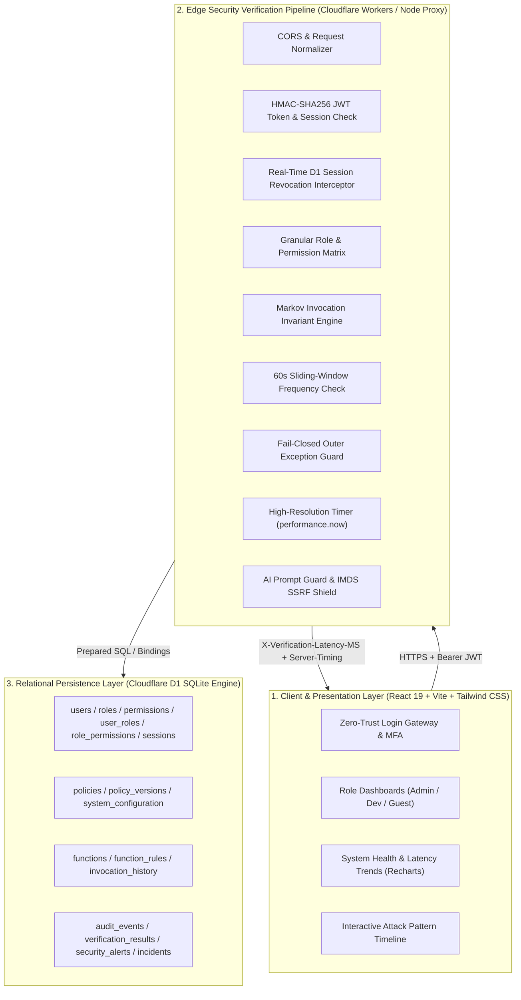

# SYSTEM ARCHITECTURE DOCUMENTATION

**Project Title:** Design and Implementation of an Integrated Real-Time Security Verification Framework for Serverless Cloud Applications  
**Academic Target:** B.Tech CSE Final-Year Capstone Project (2026–2027)  
**Research Benchmark:** *Bλambda: A Real-Time Verification Framework for Serverless Computing*, IEEE Access, 2025, DOI: 10.1109/ACCESS.2025.3572729  
**Architecture Version:** v2.5.0-Enterprise  

---

## 1. High-Level System Overview

The framework provides an inline, real-time security verification interceptor designed for edge-native, serverless architectures (Cloudflare Workers and Cloudflare D1 SQLite). The system enforces Zero-Trust principles: every function call, regardless of origin, is treated as untrusted and subjected to sequential invocation verification, sliding-window rate anomaly detection, role-based capability validation, and heuristic AI/Cloud exploit shielding.

---

## 2. Component Architectures

### 2.1 Frontend Architecture
- **Framework:** React 19 SPA running on Vite 6 with TypeScript.
- **Styling & Design System:** Tailwind CSS v4 with custom responsive light/dark design tokens (`ThemeContext`), anti-slop typography (`Plus Jakarta Sans` for UI, `JetBrains Mono` for tabular metrics and telemetry).
- **Core State Hub (`App.tsx`):**
  - Manages session lifecycle (`AuthSession`), active user identities, polling intervals, terminal stream logs, and modal view states.
  - Role-gated views: `AdminCommandCenter` (Tier 3), `DeveloperWorkbench` (Tier 2), `GuestPortal` (Tier 1).
  - Security Modals: `UserDatabaseModal` with session revocation confirmation protection, `SecurityArchitectureModal` (restricted to Admin), and `SecurityReportModal`.
- **Forensic Data Visualizations:**
  - `SystemHealthDashboard.tsx`: Built with Recharts `ComposedChart` and `AreaChart`, displaying request-to-persistence latency against target SLAs (2.0ms / 5.0ms) and user threat index distributions.
  - `InteractiveSecurityTimeline.tsx`: Interactive horizontal node ribbon tracking events chronologically with heuristic attack pattern clustering (Markov deviations, brute force bursts, revoked replay attempts) and forensic inspector card.

### 2.2 Backend Architecture
- **Dual-Runtime Compatibility:**
  1. **Development Runtime (`server.ts`):** Express 4 application with Vite middleware running on Node.js / `tsx`. Serves API routes and acts as a local proxy with D1 prepared-statement emulation.
  2. **Production Edge Runtime (`src/worker.ts`):** Native Cloudflare Workers edge handler implementing the `fetch(request, env, ctx)` contract, directly bound to Cloudflare D1 (`env.DB`).
- **Pipeline Interception Pattern:** All operational API routes (`/api/:route`) pass through an inline middleware pipeline before dispatching business logic.

### 2.3 Authentication Architecture
- **Zero-Trust Login Flow:**
  - Password verification against salted cryptographic hashes.
  - Multi-Factor Authentication (MFA) challenge requiring a second factor (TOTP / SMS) for all elevated and production accounts.
  - Real-Time Clearance Gate: User status must be explicitly `APPROVED`. Users with `PENDING_APPROVAL`, `REJECTED`, or `SUSPENDED` are rejected at the edge gateway.
- **Token Model:**
  - Cryptographically signed RFC-7519 JWT tokens containing `sub` (principal username), `role`, `iss` (`serverless-security-framework`), `iat`, `exp` (3,600s), and `jti` (session token identifier).
  - High-performance signature verification executed prior to state lookups.

### 2.4 Authorization Architecture (RBAC)
- **Three-Tier Role Hierarchy:**
  1. **Tier 3 (SecOps Administrator):** Unrestricted access. Authorized for key rotation, cloud backup purges, policy threshold reconfiguration, global perimeter lockdown, user clearance approval, and session revocation.
  2. **Tier 2 (Cloud Developer):** Authorized for dashboard telemetry reading, security log inspection, and serverless worker code deployments (`/api/deployWorkerCode`).
  3. **Tier 1 (External Compliance Auditor / Guest):** Read-only access restricted strictly to `/api/getDashboardMetrics` and compliance report generation.
- **Normalized Permissions:** Enforced through database relations (`roles`, `permissions`, `role_permissions`).

### 2.5 Invocation Verification Architecture (Bλambda Markov Engine)
- **Sequential Invariant Engine:** Enforces valid state transitions between serverless functions.
- **Markov Graph Rules:** Defines allowed transitions (e.g. `login` $\rightarrow$ `getDashboardMetrics` $\rightarrow$ `viewSecurityLogs` $\rightarrow$ `deployWorkerCode`).
- **Structural Penalty:** Out-of-sequence function jumps are flagged as `SEQUENCE_VIOLATION` and apply an immediate $+40\%$ risk penalty to the request.
- **Boundary Cutoff:** Total definitive risk is calculated as:
  $$\text{Risk}_{\text{total}} = \min(100, \text{Risk}_{\text{base}} + \text{Penalty}_{\text{sequence}} + \text{Penalty}_{\text{rate}})$$
  If $\text{Risk}_{\text{total}} \ge \text{Policy}_{\text{maxThreshold}}$ (default 75%), the request is immediately dropped with HTTP 403 Forbidden.

### 2.6 Threat Detection Architecture
- **Sliding-Window Rate Limiting:** A 60-second sliding window query counts requests from the calling identity. If request frequency $> 10\text{ req/min}$, a $+20\%$ risk penalty is applied and the event is tagged `ABNORMAL_REQUEST_RATE`.
- **AI Threat Shield & Cloud SSRF Interceptor:**
  - Evaluates payloads against heuristic signatures for Prompt Injection (`ignore previous instructions`, `DAN mode`), Link-Local Cloud IMDS SSRF probes (`169.254.169.254`, `metadata.google.internal`), and Kubernetes ServiceAccount token theft (`/var/run/secrets/kubernetes.io`).
  - Server-side integration with Gemini 2.5 Flash for advanced contextual payload analysis when enabled.

### 2.7 Audit Logging Architecture
- **Cryptographic Audit Ledger:** Dual-table persistence in `audit_events` and `security_audit_logs`.
- **Recorded Parameters:** Timestamp (ISO 8601), principal username, requested route, calculated risk score, edge verdict (`ALLOWED` | `BLOCKED`), heuristic reason string, high-resolution latency duration (`verification_latency_ms`), and categorized event type.
- **Export Standards:** Cryptographic CSV export formatted according to RFC-4180 with quote-escaped strings for external SOC-2 and ISO/IEC 27001 auditor ingestion.

### 2.8 Real-Time Event Architecture
- **Database-Level Session Revocation:** Administrators can terminate any active user session in real-time. Sets `active_sessions.revoked = 1`.
- **Edge Middleware Revocation Check:** The verification pipeline verifies the token against the revocation table on every request. Revoked sessions immediately yield HTTP 403 Forbidden (`SESSION_REVOKED`) with latency headers.

### 2.9 Database Architecture
- **Engine:** Cloudflare D1 Relational SQLite.
- **Transaction Model:** ACID compliant, atomic execution of prepared statements.
- **Schema Normalization:** 15 normalized tables supporting identities, RBAC, policy versioning, function catalogs, invocation traces, alerts, and audit logs.

### 2.10 Deployment Architecture
- **Edge Worker:** Cloudflare Workers running on V8 isolates globally distributed across Cloudflare PoPs.
- **Database Binding:** D1 database binding named `DB` in `wrangler.jsonc`.
- **Static Assets:** Vite SPA served from edge KV / static middleware.
- **Failover / Dev Proxy:** Express Node.js application (`server.ts`) simulating the D1 API for hermetic development and containerized deployments.
